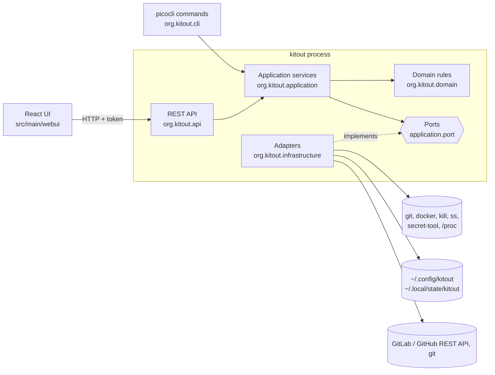
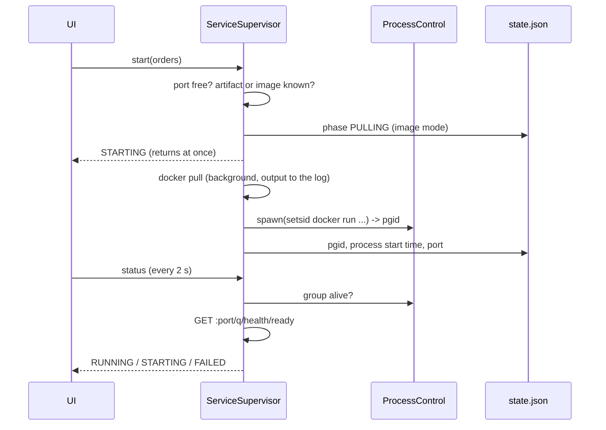
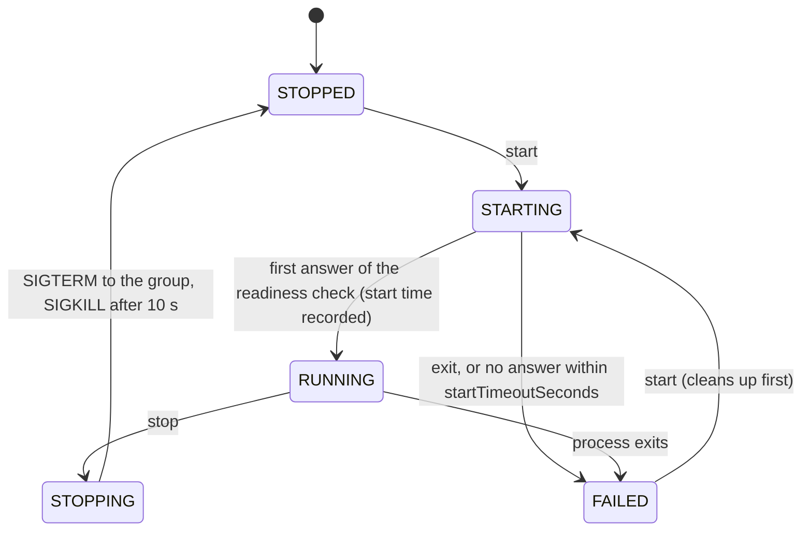
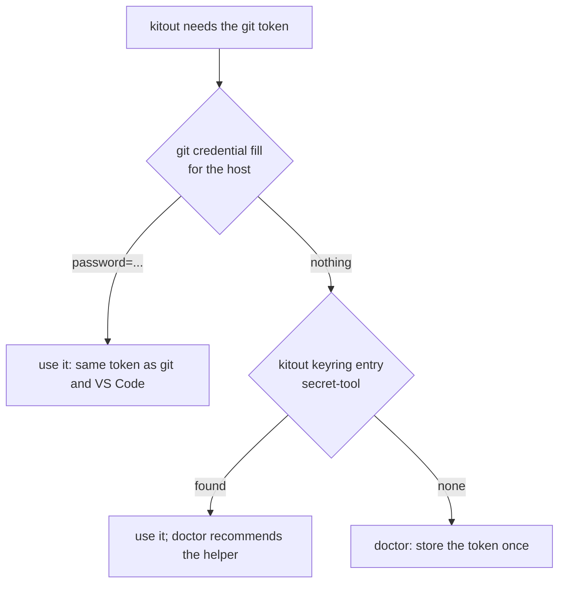

# kitout architecture

## Why kitout exists

**kitout makes sure every developer has the right environment and everything running to work on
their service, in minutes, without manual setup.**

A developer on a microservice team usually changes one service, but needs fifteen others, a
database and a broker running, each with the right version, port and settings. Today that means
wiki pages, personal scripts and asking colleagues, repeated on every new laptop and after every
upgrade. kitout replaces that with one tool on the developer's own machine, driven by one reviewed
file the team shares (`kitout-team.json`). It answers four questions, in this order:

1. **Is my machine still right?** The team's requirements (OS, Java, Maven, Docker, Node.js, ...)
   are checked on every call. When an automatic update or an upgrade changes a tool, kitout notices
   at the next call, says what changed and how to fix it, and stops before anything is built or
   started with the wrong tools.
2. **Do I have what I need?** The team's repositories, the registry login, my secrets, and the
   infrastructure (databases, brokers, tools) running.
3. **Can I work on my service now?** Everything else started in the right order, my service in the
   IDE, the right image tags, and each service's health at a glance.
4. **What is going wrong, and where?** Every service's log in one place instead of a dozen
   terminals: live, searchable, with errors and warnings highlighted, a service that fails or turns
   unhealthy marked at once, and builds, compose runs and kitout's own log next to them.

### Where kitout fits next to other tools

| Tools | Focus | What they leave open |
|---|---|---|
| Tilt, Skaffold, Garden, DevSpace | Building and deploying services into a (local) Kubernetes cluster on every change | Whether the developer's machine, access and settings are ready; everything is described by hand, nothing comes from the projects |
| Dev Containers, Codespaces, Gitpod, Coder | A container or cloud machine with the right tools | The team's services, which ones run where, tags, start order |
| Nix, devbox, mise, asdf | Pinned tool versions | Everything beyond the tools |
| Quarkus Dev Services | Containers for one service in dev mode | Many services sharing one database and broker |
| Backstage and other portals | A catalogue of services | Running them on the laptop |

kitout is not a deployment tool and not a remote environment. It is local, it reads what it can
from the projects themselves (ports, health checks, profiles, git origins), and it gets the rest
from the team file. Kubernetes, CI/CD and releases stay outside: kitout uses the images CI/CD
publishes, but never builds or deploys them.

### How we know it works

- Time from a fresh laptop (or a reset) to "my service runs in the IDE with everything else up".
- Problems caught before they cost time: wrong Java, missing secret, stale image, port conflict.
- Time to find the cause of an error across services (one place instead of a dozen terminals).

---

This document explains how kitout is built and why, for the developer who changes it next.
For step-by-step changes, see [MAINTAINING.md](MAINTAINING.md).

## The shape in one picture

One local program. A Quarkus daemon does all the work; the React UI and the CLI are thin clients
of the same core. The daemon only listens on `127.0.0.1`.



The CLI does not call the daemon over HTTP: it runs the same application services in-process
(with the HTTP server switched off, see `org.kitout.cli.Main`). Both read and write the same files
under a file lock, so `kitout up` in a terminal and the UI in a browser always agree.

## Layers and packages

| Package | Holds | May depend on |
|---|---|---|
| `org.kitout.domain` | Rules with no I/O: remote URL parsing, redaction, Quarkus config resolution, start tiers, BFF routing analysis, build and launch command lines, clone paths, native error explanations | JDK only |
| `org.kitout.application` | Use cases: workspace scan, groups, doctor and its checks, supervisor, logs, builds, clone, credentials, remote cleanup. Defines the **ports** it needs | domain, ports, CDI |
| `org.kitout.application.port` | Interfaces to the outside world: `CommandRunner`, `ProcessControl`, `SecretStore`, `GitLabApi`, `GitHubApi`, `NetworkProbe`, `SystemInfo`, plus the two repositories | domain |
| `org.kitout.infrastructure` | Implementations of the ports: `ProcessBuilder`, `setsid`/`kill`, JSON files, `secret-tool`, JDK HTTP client, `/proc` | application ports |
| `org.kitout.api` | REST resources, DTOs (`api.dto`), mapping, error mapping, the security filter | application |
| `org.kitout.cli` | `Main`, picocli commands, terminal output | application |
| `src/main/webui` | React UI: `api/` (HTTP), `lib/` (pure logic), `hooks/`, `components/`, `views/` | the REST API only |

The domain is plain Java on purpose: its 50 unit tests run in milliseconds, without Quarkus, and
it would survive a change of framework. Framework annotations needed for native images are kept
out of it (`infrastructure.NativeReflection` registers persisted records centrally).

## Core flows

### Project types

A service is a `Project` with a `ProjectType`: **Quarkus**, **Spring Boot**, **Java** (a plain
app), **Node**, or **Image** (named only in the team file). The type decides the few things that
differ; everything else (groups, registry images and tags, environment, folders and docker options,
health switch, logs, team file, requirements) is the same for every type.

| | Quarkus | Spring Boot | Java | Node | Image |
|---|---|---|---|---|---|
| Recognised by (`ProjectReader`) | `io.quarkus` in the build file | `org.springframework.boot` | a main class (`<mainClass>`, `Main-Class`, exec, Gradle `application`) | `package.json` with `dev`, `start` or `serve` | the team file's `images` |
| Config read | `%dev.` keys (`QuarkusConfig`) | `application.*` then `application-dev.*` on top (`SpringBootConfig`) | none | the script, `vite.config.*`, `angular.json` (`NodePackage`) | the team file |
| Port | `quarkus.http.port`, 8080 | `server.port`, 8080 | none (0) until set under Options | from `--port`/`-p`, the config, or the tool's default; advisory | `port` |
| Readiness | `HealthEndpoint` | `/actuator/health/readiness` with probes, else `/actuator/health`, on the management port | none: the port, or the process | none: the port | `healthPath`, or the port |
| Run modes (`ProjectType.runModes`) | image, JVM, native, IDE | image, JVM, IDE | image, JVM, IDE | image, npm script, IDE | image |
| Profile | `-Dquarkus.profile`, `QUARKUS_PROFILE` | `-Dspring.profiles.active`, `SPRING_PROFILES_ACTIVE` | none | none | none |
| Build (`BuildCommandFactory`) | `clean package -Dquarkus.profile=…`, native | `clean package` (JVM) | `clean package` (JVM) | not built | not built |
| Local output (`ArtifactLocator`) | `quarkus-app/quarkus-run.jar`, `*-runner` | the newest jar with a `Main-Class` (not `-plain`, sources, `original-`) | the same | none | none |

Rules that follow from the table:

- **Libraries are never services.** A Java build without a main class and a `package.json` without a
  start script are left out (`whyNoService` says so). Quarkus is checked first, so a Quarkus project
  that uses Spring compatibility stays Quarkus.
- **A mode the type does not have is fitted** (`ServiceSupervisor.fit`, `ProjectType.defaultMode`):
  the team default "jvm" means "local" for a Node project (its npm script) and "image" for an
  image-only service. Choosing such a mode on purpose is refused by the API with the reason, and a
  mode change for many services skips them and says which.
- **No port means the process.** A plain Java app without a port counts as started as soon as it
  runs, and as running while its process lives. With a port (Options, `kitout options --port`), the
  port is watched like any other. The developer's port replaces the detected one in one place
  (`WorkspaceService.withOverrides`), so the doctor, the status and the group start agree.
- **Node starts with npm.** `npm run <script>` (the developer's choice, else `dev`, else `start`)
  in the project folder, with `PORT` set to the watched port. A checkout without `node_modules` runs
  `npm install` first, shown as "Installing the npm packages"; Stop ends either.
- **Image-only services have no checkout.** The team file names them by repository and port; kitout's
  state folder stands in as their working folder. Pull, clean-up of remotes, builds and reset skip
  them (`Project.hasCheckout`).
- **Native builds are Quarkus-only for now.** A batch build with native selected builds the other
  Java projects as JVM and says so. Spring Boot native (`native:compile` or `build-image`) is a
  capability the type can switch on later.

### Starting one service



**State is derived, not stored.** `state.json` only says which process group belongs to which
service. The state shown is computed on each request from "is the group alive" and "does the
health endpoint answer". That is why:

- closing kitout does not stop the stack, and a restarted kitout re-adopts running services;
- the CLI and the UI never disagree;
- a crash is visible as FAILED (entry exists, group gone) until the developer starts or stops it.

A recycled pid is never adopted: the group leader's start time is stored and compared.

### Lifecycle



**Health is separate from the state.** Once a service has answered, it stays RUNNING for as long
as its process lives. Its health is reported next to the state and never stops it:

| Readiness answer | Health | Shown |
|---|---|---|
| 200 | HEALTHY | Running |
| 503 (or other) | UNHEALTHY | Running, Unhealthy chip, names of the DOWN checks |
| no answer | UNHEALTHY | Running, Unhealthy chip, "No answer on port …" |
| 404 | NO_HEALTH_CHECK | Running, "No health check" chip |

**The health check can be switched off per service** (`ServiceSettings.healthCheck`, the
**Options** dialog, `kitout options <service> --health-check off`, or `"healthCheck": false` for the
service in the team file; the developer's choice wins over the team's). Some BFFs block
`/q/health` from outside. Without the switch such a BFF would never count as started, and a group
start would wait for it until its timeout. Switched off, `ServiceSupervisor.probe` asks only whether
the service's port answers: that is "started", the health shows as NO_HEALTH_CHECK ("Health check
switched off; port … answers"), and a port that stops answering shows as Unhealthy. The readiness
endpoint is then never called.

**Where the readiness check is asked** comes from each project's config (`HealthEndpoint`):
`quarkus.http.root-path`, `quarkus.http.non-application-root-path`,
`quarkus.smallrye-health.root-path` and `.readiness-path`, or, with
`quarkus.management.enabled=true`, `quarkus.management.port` and `.root-path`. Defaults give
`/q/health/ready` on the HTTP port.

**Start time** is the time from the process start (after a pull, for images) to the first answer.
A watcher polls every 300 ms right after a start, so it is precise even when no UI is open. It is
stored with the run (`readyAt` in `state.json`), shown in the service row, `kitout status` (STARTED
IN), the group start messages, and written to the service log as `=== kitout: ready after 12.4 s ===`.

Services in IDE mode are never started by kitout; their state is read from their port. If a service
is switched to IDE mode while kitout still runs it (for example with "start all from: In my IDE"),
kitout keeps reporting and can stop that process; the IDE view applies once it is stopped.

### Managing the list of services

kitout's own source is a Quarkus project too, but never a service: `ProjectReader` skips a project
with the artifact id `kitout` or kitout's CLI entry point, so a checkout of kitout in the workspace is
not scanned, listed or started (an entry from an earlier scan disappears).

`ServiceAdminService` removes services (forget the settings, take it out of saved groups, hide its
folder from scans), removes all (also groups, workspace folders and the hidden list: a fresh
start, other settings stay), shows hidden projects again, and sets the run mode of many services
at once. Removing never touches files on disk.

**Removing is refused while kitout runs the service** (any state but STOPPED, so a FAILED service
too, since a failed start may still hold a process): HTTP 409 with "Stop it first". Remove all is
refused while any service runs, and the message names them. Removing a running service would leave
a process that kitout no longer shows, which is the kind of surprise kitout exists to prevent. IDE
services never block, because kitout does not run them. The rule is `ServiceAdminService.blocksRemoval`,
mirrored in the UI by `lib/status.ts`, which disables Remove with "Stop X before removing it".

**Stop is offered for FAILED services.** `ServiceSupervisor.stop` already ends whatever is left of a
failed start (process group, container) and clears the run, so the service becomes STOPPED and can
be started again or removed. `FolderBrowser` and
`WorkspaceService.preview` power the folder picker: browse, see which Quarkus projects a folder
holds, then add them with a normal scan.

### Registry images: tags and login

A service in **Registry image** mode runs `docker run --rm --network host` with kitout's label, so
the `localhost` URLs of the `%dev` profile work as in the IDE. No compose file is involved: the
image is `<registry>/<image path>` plus the **tag the developer chose**.

- **Image path.** Registries are laid out differently. The pattern in Settings
  (`GitLabSettings.imagePath`, rendered by `ImagePath`) says where a project's images are:
  `{namespace}/{project}` (GitLab's own registry, the default, `acme/shop/orders`), `{project}`
  (registries without groups, `orders`), `{group}/{project}`, `{path}`, or fixed text
  (`services/{project}`). The registry setting may carry a path prefix
  (`images.example.com/team`). A service that follows no pattern gets a repository of its own in
  the tag picker ("Change"; stored as the per-service image override, "Use default" goes back).

- **No default tag.** `latest` rarely fits a task (it is whatever main built last), so kitout never
  assumes it and never offers it. A new service has no tag; Start is disabled with "Choose an image
  tag first", and the doctor reports "No image tag chosen for ..." as an error, which stops a group
  start with the list of services to fix. `ServiceSupervisor.needsTag` is the rule; an older
  per-service override that names a tag still works.
- **Tag picker.** `RegistryService.tags` lists the tags of the service's repository through the
  Docker Registry HTTP API v2 (`HttpContainerRegistry`: `GET /v2/<path>/tags/list`, following
  `Link` pages; on 401 the standard token handshake with the `WWW-Authenticate` realm). It works
  for GitLab, Harbor, Nexus and other v2 registries. Tags are sorted naturally, newest-looking
  first (`ImageTags`: `mr-120` before `mr-99`, `1.10.0` before `1.9.2`); a tag can also be typed,
  e.g. one the pipeline is still building. The chosen tag is stored per service
  (`ServiceSettings.imageTag`) and pulled on every start, so a tag the pipeline moves (a branch tag)
  stays current.
- **Registry login, separate from git.** The registry may use other credentials than the git
  token. kitout does not store them: **Settings, Container registry** (or `kitout registry login`) runs
  `docker login --password-stdin` against the registry's host, and Docker keeps the login in its
  own store. `RegistryLogins` decides "logged in": first by reading Docker's store
  (`DockerCredentialStore`: `credHelpers`, `credsStore`, `auths`; keys compared by host, so
  `https://host/v1/` and `host` match; helper warnings on stderr ignored; `$DOCKER_CONFIG` and the
  snap location respected), then, if that finds nothing, by asking Docker itself
  (`docker login <host>` with stored credentials and no terminal, which fails at once when there
  are none). So a login kitout cannot read never shows as "not logged in" or blocks a start; the
  status then says why kitout cannot read it, since the tag list needs it. The doctor judges with
  `docker manifest inspect`, which uses exactly the login a pull uses. A failed pull writes the
  reason and the fix into the service log (refused login, or a tag that no longer exists).

### Container options: host folders and extra `docker run` options

Per service, in **Options** (gear button in the row) or `kitout options <service>`:

- **Host folders** (`ServiceSettings.volumes`, `VolumeMount`): a folder on this machine (`~` allowed)
  and a path in the container, optionally read-only. They become `--mount
  type=bind,source=…,target=…[,readonly]` (`DockerOptions.mount`). `--mount` rather than `-v`, because
  it refuses a missing host path instead of quietly creating an empty folder owned by root, and paths
  need no escaping. Paths are checked when saved (both given, absolute, no comma), and the host
  folder's existence when the service starts, with a sentence that names it.
- **Extra options** (`ServiceSettings.dockerArgs`): typed as in a shell (`--memory 1g --add-host
  db.local:10.0.0.5 -v ~/x:/x`), split by `DockerOptions.parse` with shell quoting rules but **no
  shell**, and put into kitout's argument list after its own options and before the image. Only
  options are accepted: a bare word would become the image (and the real image the command).
  Refused, with the reason: `--name`, `--label` (kitout finds, stops and cleans up its containers by
  them), `--network`/`--net` and `-p` (kitout runs images with `--network host`, so the `%dev`
  `localhost` URLs work and ports are already on the machine), `--rm`, `-d` (a foreground process
  is what kitout watches and logs), `-t` (control characters in the log), and `-e`/`--env-file`
  (variables belong in the service's environment, where values never show in the process list).
  Checked when saved and again at start, since `config.json` can be edited by hand.

Both apply in Registry image mode only; the dialog says so for a service that runs from a local
build or the IDE. A change applies from the next start.

### Environment variables for the services

Images built in CI do not contain the developer's local settings (database URL, user, password,
broker address). `EnvironmentService` keeps variables on two levels: **shared** (Settings,
"Environment for all services") and **per service** (the tune button in the row; wins over a
shared variable of the same name). They apply in every mode kitout starts:

- Registry image: `docker run -e NAME` per variable, **without the value**. Docker takes the value
  from its own process environment, so values never appear in the process list, the log or
  `state.json`.
- Local JVM or native build: the process environment.

**Variables for builds.** Each variable says when it applies (`EnvVar.use`, `EnvUse`): **Run** (the
default, and every variable from before), **Build** or **Run and build**. Build variables go into the
process environment of `./mvnw` or `./gradlew` when kitout builds the service
(`EnvironmentService.resolveBuild`, used by `BuildService`): `MAVEN_OPTS`, a token for a private
Maven repository that `settings.xml` reads with `${env.NEXUS_TOKEN}`, a proxy. Same two levels (the
service's own wins), same keyring for secrets; a missing secret fails the build with the sentence
where to enter it. Run variables never reach a build, build variables never reach a container. The
team file's variables are for running only. In a native build inside a container
(`quarkus.native.container-build`), Maven gets them, the build container does not.

Names may be typed as Quarkus properties (`quarkus.datasource.username`) and are stored as the
variable Quarkus reads (`QUARKUS_DATASOURCE_USERNAME`, `EnvNames`). `QUARKUS_PROFILE` is refused:
it comes from the service's runtime profile. **Secret** values (passwords, tokens) go to the
keyring through `SecretStore` (key `kitout-env/<scope>/<name>`); `config.json` and the API only know
that a value is set. A secret missing from the keyring (e.g. on a new machine) stops the start
with "enter it again".

### Keeping checkouts up to date

`GitSyncService` brings the local checkouts in line with the git server, in two steps the UI shows in one
dialog ("Pull") and the CLI as `kitout pull --check` / `kitout pull`:

1. **Check:** `git fetch`, then branch, upstream, ahead/behind (`rev-list --left-right --count
   HEAD...@{u}`) and uncommitted changes to tracked files. Nothing in the working tree changes.
2. **Pull:** `git pull --ff-only` for the selected checkouts, 4 at a time.

A pull never risks the developer's work: fast-forward only (no merge commit, no rebase); a
checkout with uncommitted changes, a detached HEAD or a branch without upstream is skipped with the
reason; a diverged branch fails with "merge or rebase in your IDE". Credentials come from
`GitEnvironment`, as for clones; messages are redacted. Pulling does not restart anything: a
service running from a local build uses the new code after a build and restart, one running from a
registry image gets it when the pipeline publishes a new image.

### Git hosts

kitout works with any git server. Cloning, pulling, the remotes check and reading single files all
use git itself, with the developer's own login (an SSH key, or git's credential helper over HTTPS).
`GitHost` names the kind of server, set in Settings, Git (team file: `git.provider`) or guessed from
the host name (`github` or `gitlab` in it); the kind adds what that server's API makes possible:

| | GitLab | GitHub | Any other git server |
|---|---|---|---|
| Clone, pull, team repositories, compose files | git | git | git |
| Team file and compose files without a clone | GitLab files API with the token; git otherwise | git | git |
| "Clone a group" | group listing (`GitLabApi`) | organization or user listing (`GitHubApi`) | not offered: name the repositories in the team file |
| Token check in the doctor | scopes and expiry | none | none |
| Default registry | `registry.<host>` | `ghcr.io` (github.com) | none: set it |

**Reading a file without a clone** (`RepositoryFiles`, `GitFileReader`): one small bare cache per
repository in `~/.local/state/kitout/git-files/<host>/<repo>.git`, set up as a partial clone. Each
read fetches the branch shallow and blob-less (`git fetch --depth 1 --filter=blob:none`: commits and
folder listings, no file contents), finds the file's blob, fetches only that blob, and prints it with
`git cat-file blob`, so the output is the file and nothing else. A server without partial clone sends
the branch's files once; that still works. Errors say what git said, and what usually helps (no login
for HTTPS, SSH key not accepted, repository not visible).

### Docker compose environments

The services need databases, brokers and the like. kitout does not define them; the team's compose
files do. `ComposeService` finds them in the folders set in Settings, Docker: every
`docker-compose-<environment>.yml` (also `compose-<env>.yaml`, `docker-compose.<env>.yml`; a plain
`docker-compose.yml` is `default`; override files are skipped) is one environment (`ComposeFile`).

Developers also work with their own compose files, named and placed as they like. **Pick compose
file** on the Docker page (or `kitout compose pick <file>`) adds any file inside the home folder that
is a compose file (a top-level `services:` key; checked without a YAML parser, at most 1 MB). It
becomes an environment named after the file (`kafka-debug.yml` is `kafka-debug`), marked
"picked", and is stored with its real path in `docker.composeFiles`. Forgetting it (the UI only
allows that once its containers are down) leaves the file untouched. A file found both in a folder
and picked counts once, as picked.

- **Up / Down** run `docker compose -f <file> up -d` / `down` in the file's folder as a job
  (`ComposeJob`, like builds): the request returns at once, the output goes to
  `~/.local/state/kitout/compose/<job>.log` and is shown live on the Docker page. One job per
  environment at a time. `down` keeps volumes, so data survives.
- **Status** is one `docker ps -a` call, read with a tab-separated template (`Container.FORMAT`).
  A container belongs to an environment when compose's label
  `com.docker.compose.project.config_files` names its file, so custom project names (in the file
  or in `.env`) do not matter. kitout's own service containers are recognised by `org.kitout.service`.
- The doctor's infrastructure check points at the Docker page when a database or broker is not
  reachable, and `ComposePortCheck` warns when a compose environment publishes a port a service
  needs (`docker compose config --format json`, via `ComposeInspector`). When the compose service
  has the service's name, the fix says what usually happened: a microservice was copied into a
  compose file, where it has to be updated by hand; let kitout run it as "Registry image" instead.
- The Docker page says so too: compose files are for databases, brokers and tools; the
  microservices run from the Services page, and their containers appear as "kitout · name".
- **Team compose files without a clone.** A team environment names its files by `repo` and `path`.
  When the repository is cloned (where kitout clones it, or anywhere with that git origin), the
  clone is used. When it is not, `TeamComposeDownloads` reads the file through `RepositoryFiles`,
  like the team file (the team file's own repository at the team file's branch,
  any other at its default branch, `HEAD`), and keeps a copy in
  `~/.local/state/kitout/team/compose/<repo>/<path>`. The copy keeps the folder name from the
  repository, so compose's project name, and with it container and volume names, match a clone; a
  clone made later takes over the same data. The copy is read again when the team file is read
  again (hourly, or Read again) or after an hour; when the server is unreachable the last copy is used,
  and a failed download is retried after two minutes, not on every page refresh. Only the compose
  file is downloaded: a file that names files next to it (`./init`, `../conf`, `env_file:`,
  `build:`; `ComposeFile.localReferences`, on the cautious side) is refused from the copy with a
  request to clone, because Docker would silently mount empty folders in their place. The Docker
  page tags such environments "from the repository".

### Starting a group

`GroupRunner` runs the doctor first; errors block the start unless forced (`--force`, or
"Start anyway" in the UI, which receives the report with HTTP 409). Then it starts
`Group.startTiers()`: all services together (or one by one with `sequentialStart`), waits until
each is RUNNING or FAILED, then **the BFFs, together**. A failed service is a warning, not a block.

**A group may have several BFFs** (`Group.bffs`; e.g. a web and a mobile BFF). They are all
entry points: they start together in the last tier, in member order, and stop first. In the UI
(Settings, Groups, Edit) each member can be made a BFF; the Services page shows them as "Start
together when those are up". The doctor checks the routing of each BFF that routes to others. A
suggested group makes every member that looks like a BFF (it has REST clients pointing at other
services) one. `config.json` from before (schema 1, `"bff": "x"`) is migrated to `"bffs": ["x"]`;
team files may use either `"bff"` or `"bffs"`.

### Native builds

`BuildService` gives every build its own process group (cancel stops the whole tree). Native
builds pass two gates: a fair in-process semaphore (which gives the queue position) and a file
lock in `~/.local/state/kitout/native-build.lock` (which extends "one at a time" to every kitout
process, e.g. a CLI build while the UI is open). Before starting, free memory is checked; after a
failure, `NativeBuildErrorExplainer` maps the log to a cause and a fix.

**Several services at once.** The Builds page (and `POST /api/builds`) builds a selection of
services with one set of options, the same controls as the build dialog of a service
(`BuildOptions` in the UI: profile, mode, skip tests). `BuildService.submitAll` starts every JVM
build at once; native builds go through the same gates and therefore run one after another. A
service that is already queued or building is skipped, with the reason.


**Clean builds.** Every build starts from scratch: `./mvnw -B clean package` (`./gradlew clean
build`). These builds are for running a service, not dev-mode increments, so nothing from an earlier
build may be left over. Because `clean` deletes `target/`, a build is refused while the service runs
from it in JVM or native mode (`ServiceSupervisor.cleanBuildConflict`; a service running as a
registry image can be built).

**IDE mode means hands off.** A service in IDE mode belongs to the developer's IDE, which works in its
`target/`. kitout does not start or stop it (it only watches its health), does not build it (Build
button disabled, refused by the backend and `kitout build`), does not delete its build output, and
leaves its `target/` alone on a reset, and does not pull its checkout: "Pull" still
fetches it (that changes no files) but shows it as "In your IDE: pull it there" and skips it
(`GitSyncService.IN_IDE`). To build or pull it with kitout, change its run mode first.

**Current builds and build attempts.** Each build overwrites the project's output, so there is only
ever one build per service and mode that can run. The Builds page shows two lists:

- **Current builds** (`CurrentBuilds`, `GET /api/builds/current`): what can run now, read from disk:
  `target/quarkus-app` (JVM) and the native runner, with the version Maven wrote next to it
  (`target/maven-archiver/pom.properties`, else the project's), when it was built, its size, and the
  kitout attempt that made it, or "outside kitout" (IDE, terminal). **Delete** removes that output after a
  confirmation, to free disk space. It stays when a running service uses it (same mode), when a build
  is writing it, and always for a service in IDE mode: the IDE works with the project's `target/`,
  whether or not kitout sees it running.
- **Build attempts** (`BuildService`, `GET /api/builds`): the last 10 per service, with logs, kept in
  `~/.local/state/kitout/builds.json` across restarts (`BuildHistory`). A succeeded attempt whose
  output a later build replaced (or that was deleted) is marked "output replaced", so it never looks
  runnable. Attempts are sortable and filterable; removing one removes its log only. Queued and
  running attempts are cancelled first.

**Project version.** `ProjectReader` reads each project's own version from its build file
(`ProjectVersion`): Maven's `<project><version>` or the parent's, with `${revision}`-style properties
resolved; Gradle's `version = "..."` or `gradle.properties`. Services and builds show it.
### Reset: starting over

`ResetService` (Settings, "Start over", or `kitout reset`) removes what kitout created, in parts the
developer picks after seeing a preview of each:

| Part | Removes | Default |
|---|---|---|
| Settings | `config.json` (with the team file's location), `state.json`, the askpass helper, the team file's cached copy and the machine readings (`team/`), and kitout's keyring entries (fallback token, secret variables, your values for the team's secrets) | on |
| Logs | service logs, compose output; kitout's own log is emptied (it is open) | on |
| Builds | the build list (running builds cancelled) and build logs | on |
| Local images | the service images kitout pulled (images of the services' repositories), leftover kitout containers | on |
| Build output | `target/` (Maven) or `build/` (Gradle) inside each project | off: the IDE may be using it |

Before removing anything it stops every service kitout runs and cancels running builds, so nothing
keeps writing into what is deleted. An image a foreign container still uses is kept and listed
(`docker rmi` without force). **Never touched:** repositories, compose files and compose data,
the docker login, git's credentials.

### Team setup: `kitout-team.json`

One versioned file in a git repository (e.g. `acme/platform/kitout-team`), reviewed through merge
requests like code. It names everything a newcomer would otherwise be told: git host and
registry, the services (**one repository each**), groups, compose environments, variables and
secret names, presets, build profiles, doctor rules, and the **requirements every developer machine
must meet**. Starter kit: `docs/team/` (`kitout-team.example.json` with `<<REPLACE: …>>` markers,
`kitout-team.schema.json` for editor help, `CODEOWNERS.example`), also written by `kitout team init <dir>`.

**Reading it.** The developer enters the location once (Setup, Settings, Team setup, or
`kitout team use --repo <group/project> --path <file>`), named the way the team file names its compose
files: the repository and the file's path from its root, plus the git host and the branch (`ref`,
default `main`; path default `kitout-team.json`). A file on this machine is the other choice
(`--file`). A pasted GitLab or GitHub link (`…/-/blob/<ref>/<path>`, `…/blob/<ref>/<path>`) is split into the fields in the UI and
still accepted as `kitout team use <url>`; `TeamSettings.of` refuses a link in the repository or path
field with the reason. `TeamService` reads it through `RepositoryFiles` (see Git hosts), keeps a copy in `~/.local/state/kitout/team/`, and reads it again every hour
(the daemon in the background; a CLI call in the foreground, at most once an hour, also when
offline). `TeamSetupParser` validates it: schema version, `minKitoutVersion`, repository paths, group
members, `needs`, variable names, requirement ids and rules. **A file with a leftover placeholder or
anything that looks like a credential is refused**, and a refused file never replaces the last good
copy: one bad merge request does not stop the team. Unknown keys are warnings (typos).

**Precedence.** built-in defaults < team file < the developer's own settings. `TeamOverlay.apply`
lays the team file over `config.json` when settings are read (`TeamAwareConfigRepository`);
`TeamOverlay.unapply` saves only what the developer changed, so team values are never copied into
`config.json` and later team changes keep reaching everyone. Git host, registry and image path
come from the team file and are read-only in Settings. Team groups appear like suggested groups;
editing one saves a personal copy.

**Variables and secrets.** `variables` are shared values (the team uses MongoDB:
`MONGO_HOST`, `MONGO_PORT`, `MONGO_USERNAME`); `secrets` are names only (`MONGO_PASSWORD`): each
developer enters a value once (Settings, Team setup, or `kitout team secret MONGO_PASSWORD`), stored in
the keyring under the same key as a personal secret. Order when a service starts: team shared <
personal shared < team per service < personal per service. A missing team secret stops only the
services that need it, with a sentence saying where to enter it, and shows as a warning on every
call. `kitout env import .env` (or "Import .env" in the UI) takes over an existing compose `.env`:
names like `*PASSWORD*`, `*SECRET*`, `*TOKEN*`, `*KEY*` go to the keyring, values the team already
sets the same way are skipped.

**Compose environments.** Files are named by repository and path
(`{ "repo": "acme/platform/infrastructure", "path": "compose/docker-compose-dev.yml" }`) and resolved
below the workspace root, wherever that repository is cloned; a path cannot leave its repository.
Several files are passed in order (`-f a.yml -f b.yml`), `profiles` as `--profile`. A repository
is looked for where kitout clones it and, if it was cloned by hand, in the clone and workspace folders
by its git origin (`RepositoryLocator`). When a file is missing, the Docker page says which and where
it was looked for.

**Started automatically.** Team environments have `autoStart` (default `true`): `kitout serve` brings
them up in the background on start, and `ServiceSupervisor.start` calls
`ComposeService.ensureTeamEnvironments()` before any service starts, which runs
`docker compose up -d` for each one whose containers are not all running and waits until it is done
(a line in the service log says so). If an environment cannot come up (repository not cloned, file
missing, compose failed), the service does not start and the message says why. `"autoStart": false`
leaves an environment to the Up button. A repository that
is not cloned yet makes the environment show "Not on this machine yet" and Up is refused until
"Clone" (Settings, Team setup, or `kitout team clone`) has run. Clone URLs are always built from the
configured git host: the team file can name paths, never another server.

### Start-up check and the setup walk-through

On every start the UI checks everything in the background (`GET /api/setup`; a slim progress line
shows while it runs). When all is in place, a message says so ("All checks passed for acme-shop:
team file, 9 machine requirements, 12 services") and the developer is on the Services page at once.
Otherwise the UI opens **Setup** (`#/setup`, also in the sidebar), which starts with "Not ready yet.
What to do" and then shows each step's status. `kitout serve` prints the same result in one line;
`kitout team` prints the whole report.

1. **Team file**: where it comes from, and each check made on it, with its problems: read, JSON and
   schema version, kitout version, placeholders, credentials, services, groups, compose, variables,
   requirement rules. If kitout's build or the environment names a team file (`kitout.team.repo` and
   `kitout.team.path`, with `kitout.team.host` and `kitout.team.ref`; or the older `kitout.team.location`),
   it is followed on the first call without asking; a mistake in it is shown on Setup above the form; "Stop following" is
   remembered, so it is not followed again by itself.
2. **This machine**: every requirement, met or not, with fixes for the ones that are not.
3. **Projects**, only after the machine check passed: the team's services as *loaded*, *on this
   machine* or *not on this machine*, and the team's other repositories (see below). **Load local
   projects** scans the clone folder and the workspace folders; **Clone missing** clones the rest
   and loads them when done. A service repository that is on disk but cannot be loaded says why
   (no Quarkus project in it, e.g. an infrastructure repository listed under `services`; another
   git origin; removed by the developer earlier) and does not hold up the setup.
4. **Your secrets**: the values the team file asks for.

**Repositories that are not services.** The team file lists them under `repositories` (e.g. the
infrastructure repository with the compose files); a repository a compose environment takes files
from counts too, even if not listed. They are cloned with the rest and shown under **Team
repositories** on the Docker page with their folder (copy button) and **Pull** (fast-forward only,
never over local changes; `kitout team pull`). They are never scanned, listed or started as services,
and a repository cannot be both.

**Common libraries** are repositories of the same kind: `javaLibraries` (Java code the services build
against, e.g. shared DTOs and clients) and `uiLibraries` (shared UI components) in the team file.
They are cloned, located and pulled exactly like `repositories` (`TeamSetup.Repository.kind`:
`repository`, `java-library` or `ui-library`), never loaded as services even when their build file
mentions Quarkus (`TeamScope` takes services only), and shown in their own sections on the Docker
page (**Common Java libraries**, **Common UI libraries**). A repository is listed once in the whole
file: as a service, a library or another repository. With a team setup built on this machine,
**Add library** on the Docker page (or `kitout team add-library <folder> [--ui]`) adds a git checkout by
its origin. kitout does not build or install the libraries (`mvn install`, `npm link`): the services'
own builds decide how they use them.

**Check again** (`POST /api/setup/check`) reads every tool again after a fix. Loading and cloning are
refused while the machine check fails (`SetupService.requireReady`, and the API filter).

**Only the team's projects.** With a team file, `TeamScope` limits what kitout takes in: a scan, the
folder picker and the services list keep only projects whose git origin is one of the team file's
services on the team's git host (a fork elsewhere, a playground, or a project without an origin
is left out and listed as such); the clone page offers, and `CloneService` accepts, only the
repositories the team file names (services and compose repositories). Without a team file, nothing
is restricted.

### Building a team setup from scratch

For a developer who starts a team, or has no team file yet: typically one compose file with the
infrastructure (database, Kafka, tools), maybe no services, and no CI/CD publishing images. Setup
step 1 offers **Build a team setup** next to "Use your team's file" (`kitout team create`), unless
kitout's build sets `kitout.team.required=true`. `TeamCreator` asks only for the essentials, prefilled
from what it finds in the usual folders (`GET /api/team/create`):

| Field | Default / found | Becomes |
|---|---|---|
| Team name | | `team` |
| Compose file(s) | Compose files found below `~/work`, `~/projects`, ... | One environment `dev` with `autoStart`; a file inside a git checkout is stored by `repo` and `path` (and that repository under `repositories`), any other as `file` (`~/…`, this machine only) |
| `.env` (optional) | The one next to the chosen compose file | Plain values to `variables`; passwords, secrets, tokens, keys to `secrets` (names only), their values to the keyring |
| Git host (optional) | The host most origins in the workspace use | `git.host`; empty means this machine only: no cloning or pulling |
| Projects folder | `~/work` | `gitlab.workspaceRoot` |
| "CI/CD publishes images" | off | Off: `serviceDefaults.runMode` JVM (local builds); on: `registry` |
| "Record this machine's tools" | on | `requirements`: the same OS release and architecture, the same Java major and vendor, this Maven up to the next major, these Docker, Compose, Node.js and git versions or newer |

The result is written to `~/.config/kitout/kitout-team.local.json`, validated by `TeamSetupParser` like
any team file, and followed at once, so everything else (checks, Setup, compose start, the team
scope) works the same. Services come later: **Load local projects** lists the Quarkus projects not
in the setup yet, and **Add to the team** (`kitout team add <folder>`) adds them (by their git
origin, on the team's host) to `services` and to the group `all`, then loads them. Only this file is
changed by kitout; a team's shared file changes by merge request. **Export kitout-team.json** (Settings,
Team setup; `kitout team export`) gives the file to commit; then everyone, the author included,
follows it with `kitout team use --repo <repository> --path <file>`.

### Service images: at most N versions kept

After each successful pull of a service image, `ServiceSupervisor.pruneOldVersions` removes older
local versions of that repository so images do not fill the disk: the newest *N* image ids stay
(Settings, Docker: 1 to 5, default 3), plus any image a container still uses; tags the pipeline
moved (`<none>`) count as older versions. `docker rmi` is never forced. The rule is
`ImageRetention` (domain, tested); the result is written to the service log.

### Machine requirements: checked on every call

```json
"requirements": {
  "enforcement": "block",
  "checks": [
    { "id": "os", "distribution": "ubuntu", "require": "24.04" },
    { "id": "java", "require": "21.*", "vendors": ["Temurin", "OpenJDK"] },
    { "id": "maven", "require": ">=3.9.0 <4.0.0" },
    { "id": "docker", "require": ">=28.5.2" },
    { "id": "node", "require": ">=22.23.4" },
    { "id": "memory", "require": ">=16384", "enforceFrom": "2026-12-01" }
  ]
}
```

**What is read.** `MachineProbe` has one fixed, read-only way to read each id; the team file says
what is required and how to fix it (`fix`, shown as text), **never which command to run**.

| id | Read from | Notes |
|---|---|---|
| `os` | `/etc/os-release` (`ID`, `VERSION_ID`) | `distribution` must match `ID`; `24.04` does not match `24.10` |
| `arch` | the JVM's `os.arch` | `amd64` is reported as `x86_64` |
| `java` | `java -version` on PATH, and `$JAVA_HOME/bin/java` | Vendor from the runtime line (Temurin, Zulu, Corretto, …, else OpenJDK). PATH and `JAVA_HOME` must agree: Maven uses `JAVA_HOME` |
| `maven` | `mvn -v`, and every project's `.mvn/wrapper/maven-wrapper.properties` | Each wrapper is checked too, as "Maven wrapper of <project>": projects build with `./mvnw` |
| `docker` | `docker version --format {{.Server.Version}}` | The Engine (server); a stopped daemon or a missing `docker` group is explained |
| `docker-compose` | `docker compose version --short` | |
| `node` | `node --version` | nvm users: start kitout from a shell where nvm is loaded |
| `git` | `git --version` | |
| `memory` | `MemTotal` in `/proc/meminfo`, in MB | |

Rules (`VersionRule`): an exact version (`24.04`), a wildcard (`21.*`), ranges joined by spaces
(`>=3.9.0 <4.0.0`), or plain text (`x86_64`). Pre-releases (`4.0.0-rc-4`) count as below their
release.

**Every call, cheaply.** `RequirementsService` keeps each reading with a fingerprint of what it
depends on (the binary the shell would run, resolved through links, with size and modification
time; `JAVA_HOME`; `/etc/os-release`; the wrapper files) in
`~/.local/state/kitout/team/requirements.properties`. While a fingerprint is unchanged the reading is
reused; an upgrade, another `java` on PATH or a new `JAVA_HOME` is read again at once. `arch` and
`memory` are read every time; a daemon that is down is asked again next time.

**Outcome.** PASS, WARN or FAIL. A failed check is a warning only before its `enforceFrom` day (to
announce a raised requirement) or when the team sets `"enforcement": "warn"`; missing team secrets
are always warnings.

**Blocking.**
- CLI (`RequirementsGate`, before picocli runs): commands that build, start, clone or pull stop with
  what was found, what is required and how to fix it, exit code **4**. `check`, `doctor`, `team`,
  `env`, `registry`, `token`, `reset`, `status`, `logs`, `stop`, `down` and `serve` always run, so
  the developer can look and fix. `kitout check` prints every requirement.
- API (`RequirementsFilter`): every request that changes something, except an allow-list (settings,
  team, env, credentials, registry, doctor, reset, stop, down, cancel), is answered with
  **412 `requirements`** while a check fails. The backend is the judge; the UI only explains.
- UI: a full-page "This machine does not meet the team's requirements" screen replaces Services,
  Docker, Builds and Clone, one card per problem with the fix and copy buttons for its commands, and
  **Check again** (reads every tool, `POST /api/requirements/check`). Settings, Doctor and the kitout
  log stay open. Warnings show as a slim notice above every page.

### Credentials



For git commands kitout itself runs, `GitEnvironment` sets `GIT_TERMINAL_PROMPT=0` (fail instead
of hang), runs SSH in batch mode, removes IDE askpass variables, and, only when kitout holds a
fallback token, sets `GIT_ASKPASS` to a tiny script that runs `kitout askpass`. git asks its
credential helpers before askpass, so the developer's helper always wins. The token never
appears in a URL, an argument, an environment variable or a log.

The **guided cleanup** (`RemoteCleanupService`) rewrites remotes that contain `user:token@`,
tests access with `git ls-remote`, and restores the original URL of any repository whose test
fails. The original URLs exist only in memory for that rollback.

## Persistence

| File | Content | Written by |
|---|---|---|
| `~/.config/kitout/config.json` | Workspace roots, git settings, per-service settings (path, run mode, image override, image tag, profile, timeout, host folders, extra docker options, health check switch), saved groups with their BFFs, build, doctor and Docker settings (compose folders), and hidden projects (folders the developer removed, e.g. libraries). Versioned schema | `JsonConfigRepository` |
| `~/.local/state/kitout/state.json` | Process group, start time, port, container of each started service | `JsonStateRepository` |
| `~/.local/state/kitout/logs/<service>.log` | Service output, written by the process itself; rotated at 20 MB, 3 kept | the service, `LogService` |
| `~/.local/state/kitout/builds/<id>.log` | Build output | the build |
| `~/.local/state/kitout/kitout.log` | kitout's own log (daemon and CLI), rotated at 10 MB, 3 kept. Shown live in the UI under **kitout log** (`GET /api/kitout/log`) | Quarkus logging; path from `KitoutPaths.kitoutLog()`, set in `cli.Main` |
| System keyring (`secret-tool`), fallback `~/.local/state/kitout/secrets/` (0600) | kitout's fallback token, secret service variables, team secrets (`kitout-env/<scope>/<NAME>`) | `KeyringSecretStore` |
| `~/.local/state/kitout/team/kitout-team.json`, `team.properties` | The last good copy of the team file, its source, commit and time | `TeamService` |
| `~/.local/state/kitout/session-token` | The key browsers send to the API (0600); deleting it, or resetting settings, asks every browser for the link again | `SessionToken` |
| `~/.local/state/kitout/team/requirements.properties` | Machine readings with their fingerprints; safe to delete | `RequirementsService` |

Both JSON files are written atomically (temporary file, then rename) under an exclusive file
lock. `KITOUT_HOME` moves everything to one folder; the tests use this. `config.json` is at schema
3: older files (schema 1: one `bff` per group) are migrated on read, with the old file kept as `config.json.bak-v1`.

Everything about a service except those few settings is **detected, never typed**: identity from
the git origin, ports and URLs from `application.properties`/`.yaml` (`%dev` first, then the
plain key, then 8080, with `${key:default}` resolved).

## Security model

| Threat | Guard | Where |
|---|---|---|
| Another website, program or user on the machine calls the local API | A session key, handed over once in the URL fragment and sent back as `X-Kitout-Token`; constant-time compare. Kept in `~/.local/state/kitout/session-token` (0600) and reused across restarts; the browser remembers it (localStorage) and forgets it when the daemon refuses it. Host and Origin checks alone stop websites, but not other programs or users on the machine | `SessionToken`, `ApiSecurityFilter`, `lib/session.ts` |
| DNS rebinding | Host header must be `127.0.0.1`, `localhost` or `[::1]` | `ApiSecurityFilter` |
| Cross-origin requests | `Origin`, when present, must be kitout's own; no CORS | `ApiSecurityFilter`, `application.properties` |
| Remote access | Server binds `127.0.0.1` only | `quarkus.http.host` |
| Command injection | Argument lists only, never shell strings; build profile validated; no user text reaches a shell | `CommandRunner`, `BuildRequest` |
| Token leaks | One `Redactor` for every output path; token never in URLs, arguments, env or API responses; write-only API for the fallback token | `Redactor`, `CredentialService`, `SettingsResource` |
| Malicious clone paths from the API | Every segment validated; target must stay inside the workspace root; only the configured host | `CloneTarget`, `CloneService` |
| Running arbitrary compose files | Up/Down take an environment id, never a path. A path enters only by picking: inside home after resolving links, a regular YAML file with top-level `services:`, at most 1 MB. Commands are argument lists | `ComposeService`, `DockerResource`, `FolderBrowser.resolveFile` |
| Registry login leaks | The password goes to `docker login` on stdin and is never stored by kitout, logged or sent back by the API; `Credential.toString` hides it; Basic auth goes only to the registry and the HTTPS token realm it names | `RegistryService`, `DockerCli.login`, `HttpContainerRegistry` |
| Service secrets leak | Secret values in the keyring, not in `config.json`; write-only API; passed to docker as `-e NAME` with the value in the environment, never in arguments | `EnvironmentService`, `LaunchPlanner.image` |
| Reset deleting too much | Only kitout's own files and keyring entries, images of the services' repositories, and build output only on request inside the project folder; preview first, explicit confirmation | `ResetService` |
| Losing local work on pull | Fast-forward only; checkouts with uncommitted changes are skipped | `GitSyncService` |
| Browsing the file system through the API | Pickers list folders below the home folder after resolving symlinks, without hidden entries, max 500 per folder. File names appear only in the compose file picker, and only for `.yml`/`.yaml` files | `FolderBrowser` |
| A team file that runs things or leaks secrets | The team file never names commands (requirements say only what is needed; kitout reads each id one fixed way) and never holds secrets (refused if `Redactor` finds one; secrets are names). Files are repository paths that cannot leave their repository; clone URLs use the configured host | `TeamSetupParser`, `MachineProbe`, `ComposeService.teamEnvironments`, `CloneService.repositories` |
| Working around the requirements | CLI gate before any command, API filter before any change; the UI screen only explains | `RequirementsGate`, `RequirementsFilter` |
| Killing a foreign process | Process start time checked before any signal; containers carry the `org.kitout.service` label | `PosixProcessControl`, `LaunchPlanner` |
| Extra docker options doing more than intended | Split without a shell, into the argument list before the image; only options; the ones kitout relies on (name, label, network, `--rm`, foreground, environment) refused; checked when saved and at start. Host folders as `--mount` with absolute paths, refused when missing | `DockerOptions`, `ServiceOptions`, `ServiceSupervisor.mounts` |

kitout has **no release function**. It never triggers the manual release job.

## Design principles, and where to see them

**Single responsibility (SOLID).** Each class has one reason to change. `ServiceSupervisor`
owns the lifecycle; launching details are in `LaunchPlanner`; finding build output is
`ArtifactLocator`; log files are `LogService`. Each doctor check is its own class.

**Open/closed.** New doctor checks are new classes; `DoctorService` collects all
`DoctorCheck` beans (`@All`) and never changes. New native error explanations are one entry in
`NativeBuildErrorExplainer.RULES`. New config migrations are one entry in
`JsonConfigRepository.MIGRATIONS`.

**Liskov substitution.** Every port implementation is interchangeable with a test double:
`Fakes.InMemoryConfig` and `Fakes.InMemorySecrets` stand in for the JSON and keyring adapters
without the services noticing.

**Interface segregation.** Ports are small and specific (`SystemInfo` has two methods,
`SecretStore` four). A doctor check that needs the network does not depend on process control.

**Dependency inversion.** Application services depend on `application.port` interfaces; the
infrastructure implements them. Swapping `secret-tool` for another keyring, or the JDK HTTP
client for another, touches one adapter.

**GRASP.** *Information expert*: `Group` computes its own start tiers and stop order;
`QuarkusConfig` resolves its own profiles and placeholders; `RepoIdentity` derives its image name.
*Creator*: `BuildService` creates `BuildJob`s because it records and uses them. *Controller*:
REST resources and CLI commands only translate requests into one application call. *Low
coupling / high cohesion*: the UI knows only the REST API; the domain knows nothing else. *Pure
fabrication*: `Redactor`, `ApiMapper`, `JsonFileStore` exist to keep responsibilities clean.
*Protected variations*: ports shield the core from git, Docker, GitLab, GitHub and the OS.
*Indirection*: `GitEnvironment` sits between every git call and the credential mechanics.

**Separation of concerns.** Domain rules, use cases, I/O, HTTP and presentation live in separate
packages with one-way dependencies. In the UI, `api/` talks HTTP, `lib/` holds pure logic
(tested with Node), `hooks/` manage data over time, `views/` render.

**Principle of least astonishment.** kitout behaves like the tools developers already know:
- configuration is read the way Quarkus reads it (`%dev` wins, placeholders resolve);
- ports are read and checked, never assigned or rewritten;
- builds use the project's own wrapper with ordinary flags;
- git runs as the developer's git, with their credential helper and SSH config;
- existing remotes are never changed, except by the cleanup, which always asks and rolls back;
- closing kitout does not stop the stack; starting what already runs does nothing; stopping twice
  is safe;
- every error says what happened and what to do, in one sentence, in UI and CLI alike;
- IDE-mode services are never touched;
- a failed service in a group is a warning, so the rest still starts.

## Decision log

| Decision | Choice | Why |
|---|---|---|
| Backend | Quarkus LTS, native executable | Team knows Quarkus; native keeps memory low and start-up fast |
| UI | React + Vite built in by Quinoa | One binary, one URL, same origin, no CORS |
| UI components | MUI (Material UI) v9 with its theme; status as `Chip`s | Accessible, keyboard-ready components the team does not maintain; one theme file for the look, light and dark |
| Status rules | One table in `lib/status.ts` for every chip and button | The same state always looks and acts the same (least astonishment); tested without a browser |
| Compose environments | One file per environment, found by name in configured folders | Matches how teams already keep `docker-compose-<env>.yml`; nothing to register |
| Team compose file, repository not cloned | Read from the repository, copy in the state folder; refused when it uses files next to it | Same "no clone needed" as the team file; never a half-working environment with empty mounts |
| Git servers | Any git server through git itself; GitLab and GitHub APIs only for extras (listing, token check, faster file reads) | No lock-in to one forge; the developer's existing git login is enough |
| Team file location | `repo` + `path` (+ host, branch), like compose entries in the team file | One way to name a file in a repository everywhere; no guessing where a link's repository ends |
| Container ↔ environment | compose's `config_files` label | Robust against custom project names; one `docker ps` for the whole page |
| Pull | `git pull --ff-only`, skip dirty checkouts | The developer's working copy is never changed in a way they did not expect |
| Log area colours | Dark terminal in both colour schemes | ERROR and WARN colours read the same everywhere |
| docker and git | Command line tools, not Java clients | Simple native build, identical behaviour to the developer's tools |
| State | Derived from process groups and health, not stored | CLI and UI agree; survives kitout restarts |
| CLI | Same core in-process, HTTP off | No second server; works without a running daemon |
| API types | OpenAPI document checked by a test, TypeScript generated from it | An API change breaks the build, not the UI at runtime |
| Token | One HTTPS token from git's credential helper | One credential for git, VS Code and kitout |
| Image tag | Chosen per service, no default, `latest` never offered | `latest` rarely matches the task; a wrong image costs more time than picking a tag |
| Project types | One `ProjectType` with its run modes and capabilities; a few type switches (reader, launch, build, output) | Spring Boot, plain Java and Node differ in how they are read, started and built, not in anything else kitout does |
| Plain Java | Only with a main class, port optional | Libraries must never appear as services; a batch job or a consumer may have no port |
| Node | An npm script with `PORT`, `npm install` when needed, never built | Frontends start next to their BFFs; a production build is CI's job |
| Image-only services | Named in the team file with repository and port | Other teams' services and other languages, without a checkout |
| Build profiles | dev, qa, prod by default, editable, any other typed | Teams name their stages differently |
| Name | kitout, base package `org.kitout` | Short, says what it does: kits out a developer's machine |
| Extra docker options | Free text, parsed without a shell, with a deny-list of what kitout relies on | Teams need options kitout cannot foresee (memory, hosts, capabilities); a structured form for each would never be complete |
| Host folders | `--mount type=bind`, not `-v` | A missing folder is an error instead of an empty root-owned folder; no escaping of `:` |
| Health check switch | Per service, team default, developer wins; "started" means the port answers | BFFs often block `/q/health`; the port is the next best signal and needs nothing from the service |
| BFFs per group | A list, started together after the other members | Web and mobile BFFs are both entry points; one tier keeps the start as fast as before |
| Common libraries | Team-file lists next to `repositories`, same clone and pull code | They are needed on disk like the compose repository, and must never be taken for services |
| Registry login | Docker's own credential store, written by `docker login` | The registry may differ from the git server; one login serves docker, kitout's pulls and the tag picker; kitout keeps no secret |
| Tag list | Registry HTTP API v2, not a git server's API | Works for any registry and with the registry's own login |
| Image path | A pattern with placeholders, plus a per-service repository | Registries differ (with or without groups, prefixes); one setting fits most, the exception stays possible |
| "Logged in" | Read Docker's store first, then ask Docker (`docker login <host>` without a terminal) | Docker is the authority; kitout's reading is needed only for the tag list and must not block anything |
| Service environment | Shared plus per service; `-e NAME` with values in the environment; secrets in the keyring | Local settings without rebuilding images; nothing secret in files, arguments or logs |
| Build environment | The same lists, each variable marked Run, Build or both | One place for a value used at both times; nothing typed twice; no build value leaks into a container |
| Team setup | One JSON file in a git repository, laid over personal settings, never copied into them | Reviewed like code; a team change reaches everyone who did not override it; one bad change keeps the last good copy |
| Machine requirements | Checked on every call with fingerprinted readings; block by default, `enforceFrom` to announce | Catches accidental upgrades at once without making every command slow; teams can raise a requirement without surprising anyone |
| UI routing | Hash routes, no router library | Log windows are plain links; one fewer dependency |
| JSX | Compiled by Vite itself, no plugin | Fewer moving parts; add the React plugin for Fast Refresh if wanted |
| UI tests | Node's built-in runner on pure modules | No test framework to keep compatible with Vite |

## Roadmap: recommended next steps

Status: **proposed**, for discussion with the team. The shared team setup (`kitout-team.json`) and
the machine requirements are built (see above); what follows is not.

### 1. Team setup: what is still open

- Presets are read and validated from the team file and listed in Settings, but not started yet
  (next section).
- Team groups' `needs` are validated; starting a group does not yet offer to start its compose
  environments first.
- Per-service `jvmArgs` and `hidden` are not part of schema version 1, nor are host folders and
  extra docker options (they are personal for now: paths differ between machines).
- Common Java libraries are cloned and pulled, not built: an "Install" action (`./mvnw install
  -DskipTests` in the library, so services resolve the local version) would be the next step.

### 2. Presets: one click for the usual setup

A preset is a named starting point: which group, which compose environments, which services run in
the IDE, how the rest runs. "Work on orders" means: compose `dev` up, orders in the IDE, everything
else from registry images. Starting a preset runs the steps in order (compose up and wait for
health, run modes, group start) and shows one progress view. Presets come from the team file (see
the sample) and can be added personally. CLI: `kitout preset start "Work on orders"`.

### 3. Personal compose overrides

Team environments already take several files and profiles. Still open: personal overlays on
top. Teams keep one compose file per environment; developers need small differences (another port, a
newer image, an extra tool container, a service switched off). Copying the team file loses its
later fixes. Compose's own answer is several files merged in order:

```bash
docker compose -f docker-compose-dev.yml -f my-override.yml up -d
```

Compose merges left to right: later files change or add to earlier ones. kitout would model an
environment as an **ordered list of files** (the team file first, then personal overlays), plus
optional **profiles** (`--profile kafka`) and an **env file** (`--env-file`):

- Docker page: "Add my override…" on an environment (picker as today), the list shown in order,
  "Preview merged config" (`docker compose -f … -f … config`), profiles as checkboxes
  (from `docker compose -f … config --profiles`).
- Up and Down always use the same list, stored with the environment, so Down finds every container
  (a different list leaves orphans).
- Container mapping keeps working: compose's `config_files` label lists all files, the first one is
  the team file.

Points the UI must explain, because they surprise people:
- Paths in every file resolve against the **project directory**, the folder of the **first** file,
  not the folder of the override.
- Lists such as `ports` are **added to**, not replaced: an override with `15432:5432` publishes
  both ports. Replace a list with `ports: !override [...]`, remove a key with `!reset`
  (Compose 2.24 or newer).
- With `-f`, Compose does not load `docker-compose.override.yml` by itself; the overlay must be
  listed.
- Changing a published port means the services must use it too (`%dev` URL or an environment
  variable); the doctor's infrastructure check notices when they do not.

### More, in suggested order

| # | Recommendation | Why |
|---|---|---|
| 4 | Combined error view: errors and warnings of all running services (and builds, compose runs, kitout) in one live, filterable list, each line linked to its service log | Completes "What is going wrong, and where?": the cause of an error across services in one place |
| 5 | "Update available" chips: background fetch every 30 min, newer registry image digests | Nobody runs stale code or images without noticing |
| 6 | Quick links per service: open in VS Code, Swagger UI, Dev UI | Fewer steps for the most frequent actions |
| 7 | Desktop notifications when a service fails or turns unhealthy | The kitout tab is usually in the background |
| 8 | Command palette (Ctrl+K): start, stop, logs, pull | Keyboard-first developers |
| 9 | "Copy diagnostics": redacted Markdown with doctor results, versions, stack, last errors | Faster help; ends "works on my machine" threads |
| 10 | Branch awareness: branch per service, switch several repositories to one feature branch | Features that span services |
| 11 | Release pipeline for kitout: native build, all tests, UI build, browser test against the mock API, releases with checksums, update notice in kitout | Quality and an easy upgrade path |
| 12 | Renovate for Quarkus LTS, MUI, React | Small, tested upgrade merge requests instead of big jumps |
| 13 | Known gaps from MAINTAINING.md: image staleness check, multi-module Maven | Completes the first version |
